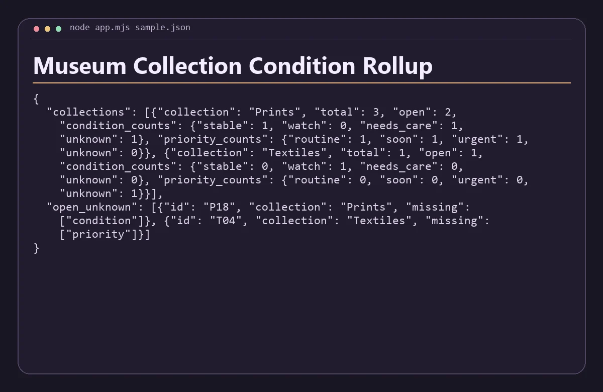

# Museum Collection Condition Rollup

Summarize recorded condition and priority across collections and flag open records with missing labels.



## Run

Install Node.js 22 or newer. Run these commands from the repository root.

```sh
node app.mjs sample.json
```

Replace `sample.json` with a JSON file following the same structure. The app prints a JSON report to standard output.

Use a unique object ID and an open or closed status. Condition labels are stable, watch, needs_care, and unknown. Priorities are routine, soon, urgent, and unknown. Missing or null labels count as unknown. The review list includes open records only. No condition or conservation priority is inferred.

## Verify

Run `python check.py` with Python 3.11 or newer after the build step when applicable. The check verifies the bundled scenario and confirms that an invalid input returns an error.
